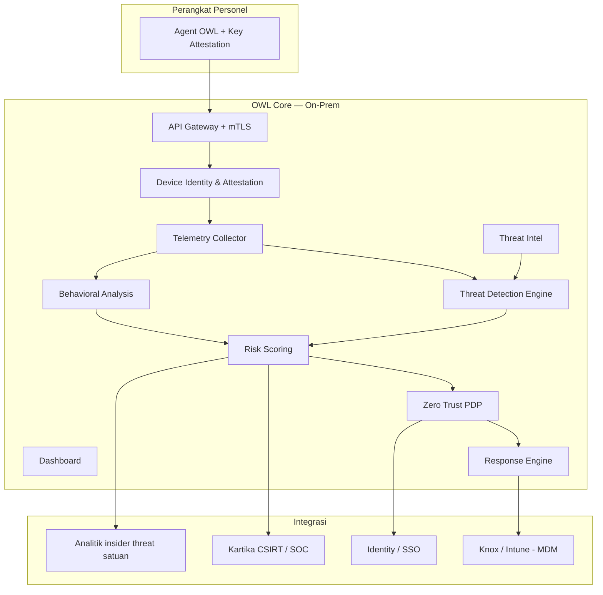

# OWL — On Device Watch Layer

> **Dokumen Analisis Mendalam — Revisi 3.0 (Technocrat Review, siap kompetisi)**
> **Posisi:** Zero Trust Mobile Risk Scoring & Conditional Access untuk armada perangkat TNI AD.
> *"Melihat & mendengar dalam gelap — menilai risiko yang tidak terlihat oleh MDM."*

| | |
|---|---|
| **Produk** | OWL — On Device Watch Layer |
| **Kategori** | Zero Trust Mobile Risk Scoring & Conditional Access (komplemen MDM + sensor SOC/CSIRT) |
| **Kompetisi** | Kartika Cyber Hackathon 2026 (PUSSIBERAD × CODEPOLITAN) |
| **Kategori Lomba** | 02 — Defensive Shield (Penangkalan) + 03 — Core Infra (Dukungan Teknologi) |
| **Dokumen** | Konsep, scope jujur, threat model, arsitektur, diferensiasi, MVP, use case, strategi menang |
| **Status** | Revisi 3.0 — seluruh temuan deep-dive juri (level 1 & 2) telah ditindaklanjuti |

---

## Daftar Isi

1. Ringkasan Eksekutif
2. Posisi & Scope Jujur (OWL adalah / bukan)
3. Relevansi Strategis untuk TNI AD
4. Identitas Produk
5. Analisis Masalah Mendalam
6. Threat Model & Batas Cakupan (MITRE ATT&CK Mobile)
7. Solusi Inti (Modul A–F + Detection Coverage + Agent Attestation)
8. Arsitektur Teknis (Zero Trust PDP + STIX/CEF + On-Prem + umpan insider threat)
9. Diferensiasi (Komplemen Knox/Intune, bukan kompetitor)
10. MVP Hackathon (Spesifikasi Buildable + Validasi Sample Nyata)
11. Use Case (TNI AD-Full)
12. Roadmap
13. Struktur Pitch Deck
14. Strategi Menang
15. Referensi

---

## 1. Ringkasan Eksekutif

**OWL — On Device Watch Layer** adalah **Zero Trust Mobile Risk Scoring & Conditional Access** untuk armada perangkat TNI AD: sebuah lapisan yang membaca sinyal keamanan perangkat (izin, aksesibilitas, CA, VPN, sideload, root, patch), **mengorelasikannya menjadi skor risiko 0–100 yang dapat dijelaskan**, lalu memakainya sebagai **keputusan akses Zero Trust** dan **sensor yang memberi makan SOC/CSIRT satuan**.

**Pergeseran positioning yang disengaja (dan jujur):** OWL **bukan** klaim "anti-surveillance total". OWL tidak bisa melihat implant baseband, IMSI catcher, firmware rootkit, atau intersepsi RF — karena itu semua berada **di bawah lapisan aplikasi**. OWL justru unggul pada apa yang bisa ia buktikan: **korelasi indikator app-layer menjadi sinyal risiko yang tidak dihasilkan MDM**.

**Peran OWL dalam ekosistem pertahanan TNI AD:**

- **Komplemen MDM** (Samsung Knox / Intune): MDM mengelola & menegakkan; OWL **menilai risiko lintas-indikator** dan **memberi keputusan akses**.
- **Sensor SOC/CSIRT**: mengirim alert & event via **STIX 2.1 / CEF (Syslog)** ke Kartika CSIRT / Satsiber.
- **Umpan ke analitik insider threat satuan**: perangkat terinfeksi = indikator awal akun/personel terkompromi.

**Prinsip kredibilitas:** semua klaim dibatasi pada indikator yang **teramati dan dapat didemonstrasikan**; tidak ada klaim deteksi yang tidak bisa dibuktikan dalam demo.

---

## 2. Posisi & Scope Jujur (Jawaban atas kelemahan #1 & #2 juri)

Ini bagian paling penting dari dokumen — batas kemampuan dinyatakan di depan, bukan disembunyikan.

### 2.1 OWL ADALAH

| Aspek | Pernyataan |
|---|---|
| **Fungsi inti** | Continuous Mobile Risk Scoring (0–100) + Conditional Access |
| **Lensa deteksi** | Korelasi indikator **app-layer**: izin, aksesibilitas, CA, VPN, sideload, root, patch |
| **Peran** | Komplemen MDM + sensor SOC/CSIRT + umpan analitik insider threat |
| **Arsitektur** | Zero Trust **Policy Decision Point** untuk perangkat mobile |

### 2.2 OWL BUKAN (dan tidak diklaim)

| Aspek | Keterbatasan jujur |
|---|---|
| Anti-surveillance total | Tidak mendeteksi implant baseband, IMSI catcher, firmware rootkit, intersepsi RF |
| Pengganti MDM | Tidak menggantikan Knox/Intune — melengkapinya |
| Hardware security | Tidak mengakses TrustZone / secure element vendor |

> **Pesan ke juri:** OWL tidak berpura-pura melihat yang tidak bisa dilihat oleh aplikasi. Nilainya adalah **korelasi + skor + keputusan akses** di atas data yang sudah tersedia — lapisan yang memang hilang dari MDM.

---

## 3. Relevansi Strategis untuk TNI AD

| Kebutuhan TNI AD | Bagaimana OWL menjawab |
|---|---|
| **Zero Trust untuk perangkat mobile** | Skor risiko device menjadi input *conditional access* (device tidak patuh → akses dibatasi/ditolak) |
| **Pengamanan IT/OT satuan** | Perangkat endpoint adalah pivot tersembunyi ke jaringan taktis/OT; OWL menutup blind spot itu |
| **Ekosistem CSIRT (Kartika CSIRT / Satsiber)** | OWL mengirim telemetri & alert via STIX/CEF sebagai sensor endpoint |
| **Insider threat & akun terkompromi** | Perangkat terinfeksi = indikator awal, diteruskan ke analitik perilaku satuan |
| **Kedaulatan data** | On-prem / air-gapped; telemetri tidak keluar lingkungan TNI AD |
| **Prosedur operasi** | *Pre-deployment device screening* + *continuous access decision* |

**Killer use case:** *Pre-deployment screening* — sebelum operasi/masuk area terbatas, perangkat di-screening; skor < ambang → akses diberikan; skor tinggi → akses ditolak + eskalasi komando.

---

## 4. Identitas Produk

**Nama:** OWL — On Device Watch Layer.

| Bagian | Makna | Fungsi |
|---|---|---|
| On | On-device | Deteksi & koleksi lokal di perangkat |
| Device | Perangkat | Android-first, lalu iOS/Windows |
| Watch | Mengawasi/memantau | Analisis izin, aplikasi, konfigurasi, perilaku |
| Layer | Lapisan keamanan | Terintegrasi di atas OS, terhubung ke MDM/SIEM/SOC |

**Tagline:** *"Melihat & mendengar dalam gelap."* — **English:** *"Sight & sound in the dark."*

**Positioning:** *"Lapisan penilaian risiko on-device untuk armada perangkat TNI AD — menilai yang tidak terlihat oleh MDM."*

**Logo:** wajah burung hantu geometris (mata radar + tanduk) dalam kontur perisai. Palet: Navy `#0B1F3A`, Teal `#14B8A6`, Amber `#F59E0B`, Slate `#64748B`, Off-white `#F8FAFC`. Tipografi: Space Grotesk/Sora (display), Inter (body), IBM Plex Mono (data).

---

## 5. Analisis Masalah Mendalam

### 5.1 Catatan Integritas Data

Tidak ada statistik nasional penyadapan ponsel terverifikasi — klaim tersebut **tidak dipakai**. Dipakai statistik **ancaman mobile & anomali siber terverifikasi**.

### 5.2 Bukti Terverifikasi (ringkas)

| Statistik | Angka | Tahun | Sumber |
|---|---|---|---|
| Pengguna internet Indonesia | **221,5 jt** (79,5%) | 2024 | [APJII](https://apjii.or.id/berita/d/apjii-jumlah-pengguna-internet-indonesia-tembus-221-juta-orang) |
| Akses internet (Susenas) | **72,78%** | 2024 | [BPS](https://www.bps.go.id/id/publication/2025/08/29/beaa2be400eda6ce6c636ef8/statistik-telekomunikasi-indonesia-2024.html) |
| Pengguna smartphone | **214,3 jt** | 2025 | [Statista](https://www.statista.com/statistics/309024/indonesia-mobile-phone-internet-user-growth/) |
| Anomali trafik nasional | **403,9 jt** | 2023 | [BSSN](https://fajarasia.id/2024/06/bssn-sebut-47-729-anomali-trafik-pada-sektor-keuangan-sepanjang-2023/) |
| Anomali Jan–Mei | **74 jt** (>44 jt malware) | 2024 | [BSSN](https://www.inilah.com/bssn-74-juta-anomali-trafik-terdeteksi-di-awal-2024-mayoritas-malware) |
| Trojan perbankan mobile | **+196%** (→1,24 jt) | 2024 | [Kaspersky](https://www.kaspersky.com/about/press-releases/banking-data-theft-attacks-on-smartphones-triple-in-2024-kaspersky-reports) |
| Malware m-banking Android | **+32%** | 2023 | [Bisnis.com](https://teknologi.bisnis.com/read/20240508/84/1763861/alert-serangan-malware-m-banking-kian-marak-naik-32-di-2023) |
| Malware mobile global | **>33 jt** | 2024 | [Securelist](https://securelist.com/mobile-threat-report-2024/115494/) |
| Ancaman lokal Indonesia | **>36 jt** | 2024 | [Kaspersky](https://id.mashable.com/tech/7387/ancaman-siber-di-indonesia-meningkat-kaspersky-deteksi-36-juta-serangan-pada-2024) |
| Aplikasi diblokir Play | **2,36 jt**; 158 rb akun | 2024 | [Google](https://blog.google/security/how-we-kept-google-play-android-app-ecosystem-safe-2024/) |
| Spyware mercenary (Pegasus) | jurnalis/aktivis/politisi | 2021–26 | [Amnesty](https://securitylab.amnesty.org/case-study-the-pegasus-project/) / [Citizen Lab](https://citizenlab.ca/research/pegasus-spyware-serbian-pro-democracy/) |

### 5.3 Narasi (diikat ke TNI AD)

Perangkat personel = titik buta yang tidak terlihat SOC/CSIRT → bisa menjadi pivot ke jaringan taktis/OT dan sumber kebocoran operasi → dibutuhkan **lapisan penilaian risiko berkelanjutan + keputusan akses Zero Trust**.

> **Kalimat kunci:** *"Satuan memagari server dan jaringan, tetapi perangkat komunikasi personel adalah titik buta — OWL mengubahnya menjadi keputusan akses yang terukur."*

---

## 6. Threat Model & Batas Cakupan

### 6.1 Adversary

| Adversary | Tujuan | Vektor (app-layer) |
|---|---|---|
| Kriminal siber | Pencurian kredensial & data | Trojan banker, phising, overlay, aksesibilitas |
| Vendor spyware komersial | Akses penuh perangkat | Spear-phishing, sideload, rogue CA/VPN |
| Insider/akun terkompromi | Eksfiltrasi data satuan | Perangkat terinfeksi sebagai pivot |

### 6.2 Batas Cakupan (jujur)

| Vektor | Dicakup OWL? | Alasan |
|---|---|---|
| App-layer (izin, aksesibilitas, CA, VPN, sideload, root, patch) | **Ya** | Teramati via API publik OS |
| Firmware rootkit / implant baseband / IMSI catcher / RF | **Tidak** | Di bawah lapisan aplikasi; di luar jangkauan API |

> OWL adalah **lapisan app-layer**; perlindungan terhadap ancaman baseband/firmware/RF ditangani sistem lain (SIGINT/proteksi perangkat keras) di luar scope produk ini.

### 6.3 Pemetaan MITRE ATT&CK Mobile

| Taktik | Teknik | Sinyal OWL | Feasibility |
|---|---|---|---|
| Initial Access | T1444 Masquerading, T1478 Install 3rd-party | Sideload, paket mencurigakan | **A** |
| Persistence | T1624 Event Triggered, T1402 Broadcast | Foreground service, receiver | **A** |
| Privilege Escalation | T1404 Exploitation, T1397 Root | Play Integrity gagal, artefak su/Magisk | **A** |
| Defense Evasion | T1512 Masquerading, T1407 Download Code | Signature/versi tak konsisten | **A (terbatas)** |
| Credential Access | T1417 Accessibility, T1411 Input Capture | `BIND_ACCESSIBILITY_SERVICE` + overlay | **A** |
| Collection | T1429 Audio, T1512 Camera, T1430 Location | Izin mic/kamera/lokasi + perilaku | **A (terbatas)** |
| Exfiltration | T1437 Exfil Over C2 | Volume/DNS/destinasi tak wajar | **A (terbatas)** |

---

## 7. Solusi Inti

### 7.1 Modul A–F (ringkas)

- **A — Endpoint Agent:** baca izin, aplikasi, root (Play Integrity + artefak), aksesibilitas, device admin, CA user-installed, VPN, patch, metadata jaringan.
- **B — Detection Engine:** rule deterministik atas indikator di atas.
- **C — Behavioral (korelasi multi-sinyal):** ≥2 sinyal untuk menekan false positive.
- **D — Risk Scoring (0–100):** bobot + severity + decay (lihat §7.2).
- **E — Dashboard:** inventory, heatmap, kontributor, alert, compliance.
- **F — Response & Conditional Access:** notifikasi, eskalasi, kuarantin, dan **keputusan akses** (lihat §7.3).

### 7.2 Risk Scoring — dengan dasar kalibrasi (jawaban kelemahan #5)

**Bobot kategori & rationale:**

| Kategori | Bobot | Dasar logis |
|---|---|---|
| Perilaku runtime (aksesibilitas, overlay) | 30 | Indikator paling langsung pencurian kredensial/abuse |
| Integritas aplikasi (sideload, izin berlebih) | 25 | Vektor masuk utama |
| Konfigurasi (CA, VPN) | 20 | Indikator MITM |
| Integritas perangkat (root, patch) | 15 | Pengungkit semua serangan |
| Identitas | 10 | Sinyal lintas kategori, kurang langsung |

**Severity:** low=1, medium=2, high=3, critical=5 (skala kualitatif setara CVSS: Low/Medium/High/Critical).

**Formula:** `Skor = min(100, Σ severity × bobot_normalisasi)`, **decay** −5/hari tanpa sinyal.

**Validasi kalibrasi:** bobot diuji dengan **analisis sensitivitas** dan **korpus malware publik** (Drebin/AndroZoo) untuk mengukur True/False Positive — dijalankan saat MVP, bukan diklaim sebelum diukur.

**Ambang & kebijakan akses (Zero Trust):**

| Skor | Level | Kebijakan akses |
|---|---|---|
| 0–29 | Rendah | Allow |
| 30–69 | Sedang | Allow + step-up (MFA) |
| 70–89 | Tinggi | Akses terbatas / tolak aplikasi sensitif |
| 90–100 | Kritis | Deny + kuarantin |

### 7.3 Conditional Access (Zero Trust PDP)

OWL bertindak sebagai **Policy Decision Point input**: skor risiko device diteruskan ke Identity/MDM sebagai sinyal *conditional access*. Ini adalah nilai unik yang **tidak diberikan MDM** — MDM tahu "device terdaftar/tidak", tetapi tidak menilai **risiko lintas-indikator secara berkelanjutan**.

### 7.4 Agent Attestation — "siapa yang mengawasi pengawas" (jawaban kelemahan #4)

- **Android Key Attestation:** agent memegang kunci di hardware-backed Keystore (StrongBox/TEE); sertifikat attestation membuktikan identitas & integritas agent.
- **Play Integrity API:** memverifikasi agent adalah build asli yang ditandatangani (bukan repackaged/tertamper).
- **Hasil:** laporan "perangkat bersih" terikat kriptografis pada instance agent yang terverifikasi — bukan agent yang dikuasai penyerang.

### 7.5 Detection Coverage Matrix (kejujuran)

| Ancaman | Metode | Feasibility | Confidence | Risiko FP |
|---|---|---|---|---|
| Abuse Accessibility | Cek `BIND_ACCESSIBILITY_SERVICE` + allowlist | **A** | Tinggi | Sedang |
| Overlay | Cek `SYSTEM_ALERT_WINDOW` (Android 12+) | **A (terbatas)** | Sedang | Tinggi |
| Rogue CA | CA user-installed + VPN + fingerprint | **A** | Tinggi | Sedang |
| Rogue VPN | Profil VPN + allowlist org | **A** | Sedang | Sedang |
| Sideload | Sumber instalasi | **A** | Tinggi | Rendah |
| Root | Play Integrity + artefak | **A** | Tinggi | Sedang |
| Patch usang/tamper | Security patch + boot status | **A** | Tinggi | Rendah |
| Spyware zero-day (Pegasus) | IOC tidak langsung saja | **D/C** | Rendah | — |
| Konten terenkripsi | Metadata/DNS/volume saja | **D** | — | — |

---

## 8. Arsitektur Teknis

### 8.1 High-Level



### 8.2 Keamanan & Kedaulatan

mTLS 1.3 · AES-256 · OAuth2/OIDC · least privilege · micro-segmentation · **on-prem/air-gapped-ready** · telemetri = indikator (bukan konten).

### 8.3 Integrasi Nyata — Payload STIX/CEF (jawaban kelemahan #7)

**STIX 2.1 bundle (contoh):**

```json
{
  "type": "bundle",
  "id": "bundle--owl-0001",
  "objects": [
    {
      "type": "indicator",
      "id": "indicator--owl-accessibility-abuse",
      "name": "abuse_of_accessibility_service",
      "pattern": "[x-oca-asset:permissions CONTAINS 'BIND_ACCESSIBILITY_SERVICE']",
      "valid_from": "2026-11-12T00:00:00Z"
    },
    {
      "type": "observed-data",
      "id": "observed-data--owl-0001",
      "first_observed": "2026-11-12T08:00:00Z",
      "object_refs": ["0"],
      "objects": {
        "0": {
          "type": "x-oca-asset",
          "device_id": "ANDROID-0001",
          "device_risk_score": 87,
          "risk_contributors": ["accessibility_abuse", "rogue_ca", "sideload"]
        }
      }
    }
  ]
}
```

**CEF (Syslog) contoh:**

```
CEF:0|OWL|OnDeviceWatchLayer|1.0|100|Mobile Risk Score Critical|9|deviceId=ANDROID-0001 cs1Label=riskScore cs1=87 cs2Label=severity cs2=critical cat=endpoint
```

**Webhook contract:**

```
POST /v1/webhooks/soc
X-OWL-Signature: HMAC-SHA256(payload, secret)
{ "event": "risk_threshold_breached", "device_id": "...", "risk_score": 87, "severity": "critical", "stix_bundle": {...} }
```

### 8.4 Umpan ke analitik insider threat

Skor risiko OWL menjadi **input** penilaian insider threat satuan. Perangkat yang terkompromi adalah indikator awal akun atau personel yang terkompromi. OWL berperan sebagai sensor endpoint; korelasi perilaku dan orkestrasinya dikerjakan sistem analitik satuan, lewat jalur STIX dan CEF yang sama dengan jalur ke CSIRT.

---

## 9. Diferensiasi — Komplemen Knox/Intune (jawaban kelemahan #3)

| Kapabilitas | Knox / Intune (MDM) | OWL (menambahkan) |
|---|---|---|
| Enroll & kelola perangkat | Ya | Tidak menggantikan |
| Device integrity | Ya (hardware-backed) | Melengkapi |
| **Korelasi lintas-indikator** | Terbatas | **Inti OWL** |
| **Skor risiko berkelanjutan (explainable)** | Tidak | **Inti OWL** |
| **Conditional access berbasis risiko** | Parsial | **Inti OWL** |
| **Feed SOC/CSIRT via STIX/CEF** | Terbatas | **Inti OWL** |

**UVP (terukur):**
> **"Lapisan risk-scoring yang membaca sinyal yang sudah tersedia di perangkat (aksesibilitas, CA, VPN, sideload, root, patch), mengorelasikannya menjadi skor risiko yang dapat ditelusuri, dan memakainya sebagai keputusan akses Zero Trust serta feed ke SOC/CSIRT — di atas MDM yang sudah ada."**

---

## 10. MVP Hackathon

### 10.1 Fitur Demo

Registrasi · postur keamanan · analisis izin · deteksi aplikasi mencurigakan · skor risiko · dashboard · alert · **conditional access** + **export STIX/CEF**.

### 10.2 Agent Android (Kotlin)

`PackageManager` (izin, sumber instalasi) · `AccessibilityManager` · `DevicePolicyManager` · KeyChain/TrustStore (CA) · `VpnService` · `Settings.Secure` · Play Integrity + artefak root · `Build` (patch level) · TrafficStats/DNS (metadata).

### 10.3 Backend & Dashboard

FastAPI/Go + rule YAML + risk scoring + PostgreSQL (SQLite demo) · React + D3/Recharts.

### 10.4 Validasi Sample Nyata (jawaban kelemahan #6)

- Ambil **hash/IOC trojan banker publik** (mis. Bian.h / Anatsa / Cerberus dari threat report publik) dan korpus publik (Drebin/AndroZoo).
- Jalankan indikator statis OWL terhadap sample → ukur TP/FP.
- **Tunjukkan satu deteksi sample nyata** di demo (bukan hanya aplikasi buatan sendiri).

### 10.5 Demo Script (3 menit)

1. (0:00) Registrasi 2 perangkat: bersih vs terinfeksi (sample nyata/APK indikator).
2. (0:30) OWL memindai → skor: bersih 18, terinfeksi 87 + kontributor.
3. (1:30) **Conditional access:** bersih → allow; terinfeksi → deny/quarantine.
4. (2:00) **Export nyata:** event STIX/CEF keluar ke SOC (tampilkan payload).
5. (2:45) Attestation agent ditampilkan (Play Integrity OK).

---

## 11. Use Case (TNI AD-Full)

| # | Use Case | Deteksi | Respons | Dampak |
|---|---|---|---|---|
| 1 | Pre-deployment screening prajurit | Skor < 60 detik | Allow/deny + eskalasi | Cegah perangkat berisiko masuk operasi |
| 2 | Perangkat komunikasi personel | Root/anomali/aksesibilitas | Kuarantin + eskalasi | Putus penyadapan taktis (app-layer) |
| 3 | Akses sistem terklasifikasi | Overlay + aksesibilitas | Deny + invalidasi sesi | Cegah pencurian kredensial |
| 4 | Perwira berisiko tinggi | IOC tidak langsung | Peringatan dini | Kurangi paparan (app-layer) |
| 5 | Personel infrastruktur kritikal | Kredensial + jaringan | Blokir akses bersyarat | Cegah pivot ke OT/SCADA |

**Prinsip privasi:** consent · data minimization · proportionality · purpose limitation · transparency · least privilege.

---

## 12. Roadmap

| Fase | Tujuan | Deliverables | Metric |
|---|---|---|---|
| 1 Foundation & MVP | Pipeline end-to-end + attestation + STIX export | Agent, backend, dashboard, PDP | 8 fitur demo |
| 2 Advanced Detection | Rule + threat intel | Deteksi spyware/CA/VPN | FP ↓ |
| 3 Behavioral Analytics | Korelasi + ML | Baseline + anomali | FP < 10% (diukur) |
| 4 Automated Response | Playbook + MDM/IAM | Auto-response | MTTR ↓ |
| 5 Multi-Platform | iOS + Windows | Agent iOS/Win | Coverage |
| 6 Enterprise & Gov | Produksi | HA, on-prem, compliance | Adopsi satuan |

---

## 13. Struktur Pitch Deck

| # | Slide | Kalimat kunci |
|---|---|---|
| 1 | OWL — Zero Trust Mobile Risk Scoring | *Melihat & mendengar dalam gelap* |
| 2 | Masalah: endpoint titik buta satuan | *Semua hal penting di genggaman prajurit* |
| 3 | Lanskap ancaman (data terverifikasi) | *Penjahat menyasar perangkat Anda* |
| 4 | Gap: MDM mengelola, tidak menilai risiko | *Endpoint adalah titik buta* |
| 5 | Solusi: risk scoring + conditional access | *Menilai yang tidak terlihat MDM* |
| 6 | Cara kerja: telemetri → skor → akses | *Dari perangkat ke keputusan akses* |
| 7 | Fitur: korelasi, skor explainable, attestation, STIX | *Bukan antivirus biasa* |
| 8 | Demo: bersih vs terinfeksi + deny/allow | *Ini nyata, bukan konsep* |
| 9 | Arsitektur: Zero Trust PDP + on-prem + umpan insider threat | *Terintegrasi ke CSIRT satuan* |
| 10 | Pengguna: screening prajurit, akses terklasifikasi, pivot OT | *Dari satuan sampai operasi* |
| 11 | Roadmap | *Dari purwarupa ke kedaulatan* |
| 12 | Penutup | *Keamanan endpoint adalah pertahanan kita* |

---

## 14. Strategi Menang

### 14.1 Skor (setelah pivot)

| Kriteria | Skor | Alasan |
|---|---|---|
| Relevansi (25%) | **9** | Zero Trust & conditional access = kebutuhan nyata TNI AD |
| Inovasi (25%) | **8** | Lapisan korelasi + PDP di atas MDM |
| Purwarupa (25%) | **9 (jika dibangun)** | Buildable + sample nyata + STIX export |
| Implementasi (15%) | **8** | Komplemen MDM, on-prem, attestation |
| Dokumentasi (10%) | **9** | Lengkap + jujur |

### 14.2 Pemetaan Temuan Juri → Perbaikan

| Temuan juri | Solusi di dokumen |
|---|---|
| Layer blindness (baseband/RF) | §2.2 & §6.2 — scope jujur |
| Redundan vs Knox/Intune | §9 — posisi komplemen |
| Agent jadi vektor | §7.4 — Key Attestation + Play Integrity |
| Skor arbitrer | §7.2 — rationale + validasi korpus |
| Demo self-referential | §10.4 — sample nyata |
| Integrasi di kertas | §8.3 — payload STIX/CEF + webhook |
| Identitas ganda sipil/militer | §11 — TNI AD full |

### 14.3 Fitur Penjualan Utama

> **"Korelasi lintas-indikator menjadi skor risiko yang dapat ditelusuri, yang diubah menjadi keputusan akses Zero Trust — lapisan yang hilang di atas MDM yang sudah ada."**

### 14.4 Pitch Scripts

**30 detik:** "MDM mengelola perangkat, tapi tidak menilai risiko. OWL, On Device Watch Layer, membaca izin, aksesibilitas, sertifikat, VPN, dan integritas perangkat — mengorelasikannya menjadi skor risiko yang dapat dijelaskan, lalu memakainya sebagai keputusan akses Zero Trust dan feed ke SOC/CSIRT satuan. Melihat & mendengar dalam gelap."

**5 menit:** 1) Masalah & data · 2) Solusi (risk scoring + conditional access) · 3) Demo (deny/allow + STIX export) · 4) Arsitektur (PDP + on-prem + umpan insider threat) · 5) Dampak & adopsi.

**Closing:** *"Kita tidak bisa melindungi apa yang tidak bisa kita nilai — OWL memberi penilaian itu."*

---

## 15. Referensi

APJII 2024 · BPS 2024 · BSSN 2023–24 · Kaspersky 2023–24 · Google 2024 · Statista 2025 · Amnesty Security Lab · Citizen Lab · ESET H1 2024 · **MITRE ATT&CK Mobile** (https://attack.mitre.org/matrices/mobile/) · **OASIS STIX 2.1** (https://oasis-open.github.io/cti-documentation/).

---

*Revisi 3.0: positioning diubah dari "anti-surveillance" (overclaim) menjadi "Zero Trust Mobile Risk Scoring & Conditional Access" (dapat dibuktikan). Batas cakupan dinyatakan jujur, diferensiasi diposisikan sebagai komplemen MDM, agent diberi hardware-backed attestation, integrasi diberi payload STIX/CEF konkret, dan rencana validasi memakai sample malware nyata — menghilangkan kelemahan yang tersisa dari deep-dive juri.*
